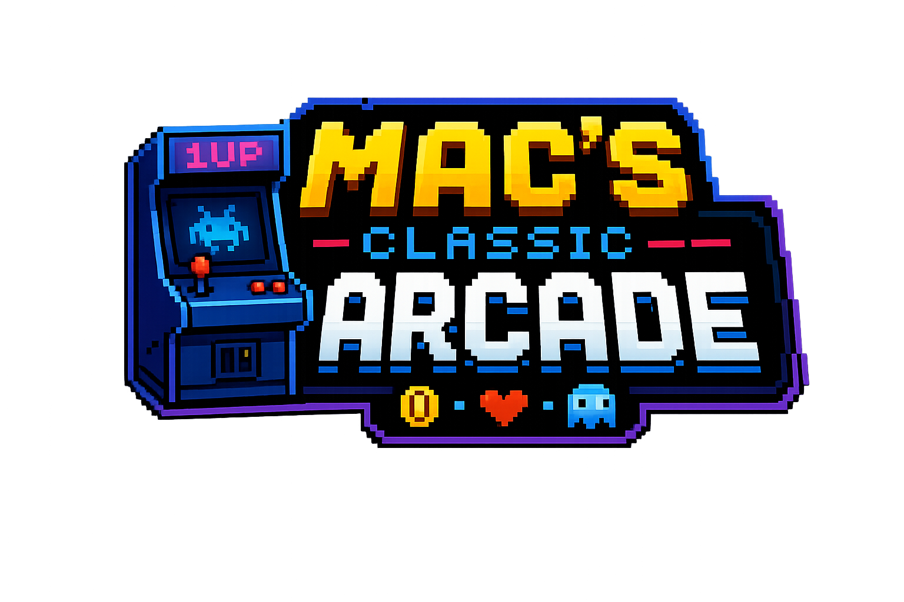

  

# 🕹️ Mac's Classic Arcade

Welcome to Mac's Classic Arcade - a retro-inspired browser arcade featuring classic games reimagined for the web. Jump in and play everything from Snake and Pong to Asteroids, Chess, and Minesweeper, all in one place!

**🎮 [Play Now - Live Arcade](https://main.d26gle35aeik8d.amplifyapp.com/)**

## 🎯 About

Mac's Classic Arcade is a growing collection of browser-based games built with a focus on simplicity and nostalgia. Each game runs in complete isolation, offering a pure gaming experience without ads, trackers, or complexity. Just pick a game and play!

Currently featuring 40+ games including:

- **Action**: Snake, Flappy Bird, Asteroids, Duck Hunt, Frogger
- **Puzzle**: 2048, Minesweeper, Sudoku, Nonogram, Lights Out
- **Strategy**: Chess, Checkers, Connect Four, Othello
- **Arcade Classics**: Pong, Breakout, Space Invaders, Pac-Man style games
- **And many more!**

## 🛠️ Tech Stack

Built with pure vanilla JavaScript and modern web standards:

- **Vanilla JavaScript (ES6)** - No frameworks, just clean code
- **iframe Architecture** - Each game runs in complete isolation
- **Pure CSS** - Retro arcade aesthetic with smooth animations
- **Hosted on AWS Amplify** - Fast, reliable, global delivery

The minimalist approach means fast load times, zero dependencies, and games that will run on any modern browser.

## 🚀 Coming Soon

The arcade is constantly evolving! Here's what's on the roadmap:

### 🎵 Audio Experience

- Sound effects for game actions
- Background music themes
- Volume controls and audio preferences

### 🏆 Progression System

- **Achievements System** - Unlock badges across all games
- **Global Currency** - Earn coins from gameplay to unlock premium features
- **Game Unlocks** - Start with core games, unlock more as you play
- **Skins & Customization** - Personalize your arcade experience

### 📊 Competition Features

- **Per-Game Leaderboards** - Compete for high scores in each game
- **Daily Challenges** - Random game modifiers for bonus rewards
- **Player Stats** - Track your performance across all games

### 🎲 Enhanced Discovery

- **Random Game Button** - Feeling lucky? Let the arcade choose!
- **Game Categories & Filtering** - Find games by mood or genre
- **Recently Played** - Quick access to your favorite games

### 🔐 User Accounts

- Save your progress across devices
- Personal achievement showcase
- Friend leaderboards and challenges

## 🎨 Design Philosophy

**Modular & Scalable** - Each game is self-contained and independent. New games can be added without touching existing code.

**Performance First** - No heavy frameworks, no bloat. Games load instantly and run smoothly.

**True Isolation** - iframe-based architecture means games can't conflict with each other, making the arcade stable and reliable.

**Browser Native** - Leveraging modern web APIs and ES6 modules for a native-feeling experience.

## 📱 Browser Support

Mac's Classic Arcade works on all modern browsers:

- Chrome, Firefox, Safari, Edge (latest versions)
- Desktop and mobile devices
- Requires JavaScript enabled

## 🤝 Contributing

Interested in adding a game or feature? Contributions are welcome! Each game is a standalone HTML/CSS/JS project in the `/games` directory.

- **Add a Game**: [Submit a Pull Request](../../pulls) with your game in a new `/games/your-game/` folder
- **Report Bugs**: [Open an Issue](../../issues) if you find any bugs or have suggestions

## 📄 License

Open source and free to play.
